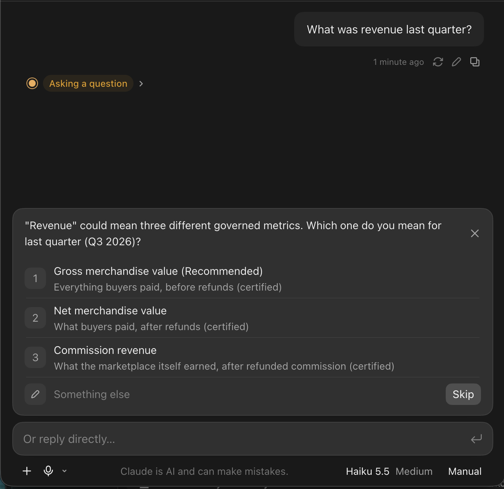
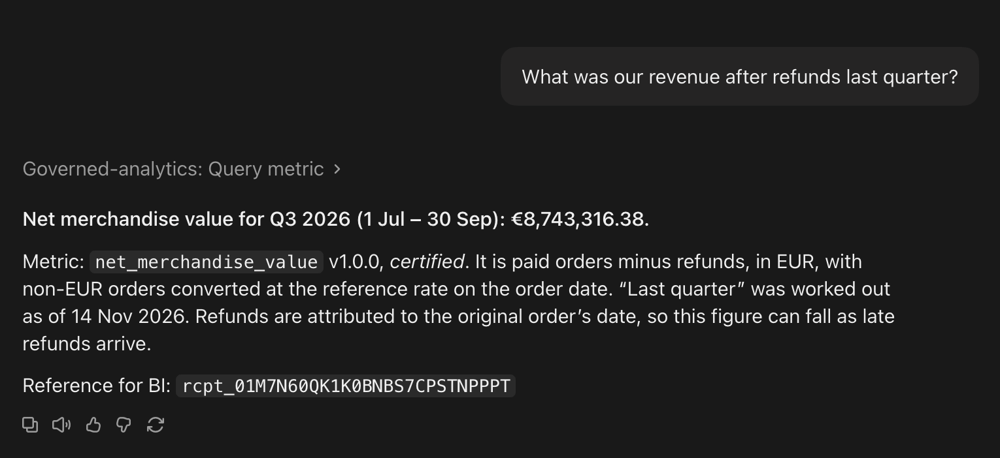
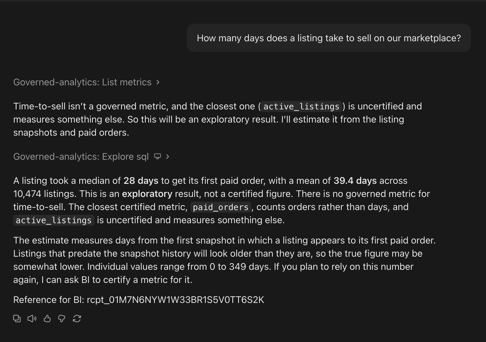
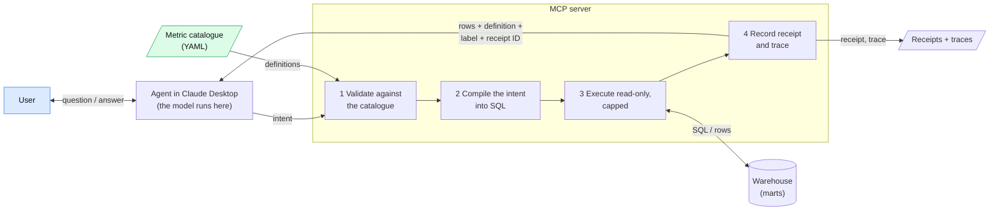

# AI Enablement Kit

A reusable kit for helping non-technical teams adopt AI assistants without losing trust in the results: agent skills, hard guardrails, contribution tiers, contracts and decision records. It is demonstrated on one worked example, **self-serve analytics drift**.

## See it work

Taken in Claude Desktop on Claude Haiku 5.5, with the server connected.

**An ambiguous question.** "Revenue" could mean three governed metrics, so the agent asks which one is meant.



**A certified answer.** The figure comes with its definition, version and a reference BI can replay.



**An exploratory answer.** No metric covers the question, so the answer is labelled exploratory and certification is offered.



Asked a day apart, the same question gave a median of 31 days (Q3 listings only) and 28 days (all listings). Both were labelled exploratory, which is the point: exploratory answers can drift, so only certified metrics go into reports.

## The problem

**Same data, same question, €8.53M to €10.30M depending on the definition.** Ask for "revenue last quarter" over the example's synthetic marketplace and reasonable readings of the same orders land anywhere in that range: gross or net, refunds by order date or refund date, failed orders in or out, order-date or payment-date FX ([ADR-004](docs/adr/004-synthetic-data-and-traps.md)). Once an assistant can query the warehouse, every team picks its own reading. Figures stop being reproducible, charts go back to BI to be double-checked, and unverified numbers reach decisions. This is a governance problem, not a prompting problem: a lower temperature doesn't make two definitions agree.

## The approach

- **The model chooses, code computes.** The assistant picks a governed metric and fills in a structured request. A deterministic compiler turns that into SQL, so the same request always gives the same number, with a receipt BI can replay.
- **Hard guardrails versus soft ones.** Skills shape behaviour, and the model follows them probabilistically. Anything that must always hold is one of eight requirements in [`requirements/`](requirements/), enforced in code, config or CI and tested by ID (`pytest -m gr04`). A skill is never the only control.
- **Certified versus exploratory, for metrics and for skills.** Certified metrics are owned by BI and change-controlled. Anything else is answered by guarded SQL, labelled *exploratory*, and can be sent to BI for certification. Skills follow the same pattern: every skill starts in `community/` and reaches `certified/` only through a promotion PR with an owner, an eval and a version ([CONTRIBUTING](CONTRIBUTING.md)).

**How a question becomes a number.** The model sends an intent; the server validates, compiles, executes and records it ([architecture](examples/governed-analytics-mcp/architecture.md)).



## Built / Deliberately not built / Who it hands off to

**Built**
- An MCP server with five tools, a seven-metric catalogue over dbt marts, the compiler, receipts with replay, and a trace log with OpenTelemetry field names.
- Seeded synthetic data with deliberate traps, modelled in dbt.
- Six skills: one certified (`mcp-tool-design`) and five in community.
- Golden-question evals, guardrail reviews, and a hand-off pack.

**Deliberately not built**
- **Scheduled live model evals.** Model-in-the-loop evals are a local command whose transcripts are committed and re-judged in CI by fixed rules ([ADR-008](docs/adr/008-model-in-the-loop-evals.md)). Running them on a schedule, tracking trends and adding LLM-as-judge are an ML / data science hand-off.
- **Harder model evals.** On four single-turn questions with descriptive tools, the tools already do most of the skill's work. Finding what the skill adds needs harder checks, such as longer conversations and weaker tool descriptions.
- **A production semantic layer.** A YAML catalogue shows the principle ([ADR-001](docs/adr/001-metric-catalogue.md)).
- **Hosted tracing.** JSON lines queried in DuckDB, ready for an OTLP exporter ([ADR-003](docs/adr/003-trace-log.md)).
- **Warehouse roles and SSO, a review UI, and user research.** The personas are synthetic and labelled as assumptions.
- **Tool selection depends on context.** A bare question such as "How many days does a listing take to sell?" was answered from a web search; with "on our marketplace" it used the governed tools. In a rollout, the connector and skill descriptions should name the business's own terms.

**Who it hands off to**

| Team | Takes on |
|---|---|
| BI | Metric definitions, certification queue, replaying disputed numbers |
| ML / data science | Live model evals, monitoring, LLM-as-judge |
| Tool enablement | Packaging the server as a connector, distributing certified skills |
| IT | Read-only warehouse role, PII masking, SSO, log retention |

## Rolling this out

| Phase | Who | Gate to move on |
|---|---|---|
| 1. Pilot | Finance and BI | Finance's recurring review figures come from certified metrics, and BI can replay any disputed number from its receipt |
| 2. Widen | Sales/Ops | The pilot measures hold with a second team, and the most-repeated exploratory questions have been reviewed by BI |
| 3. Hand off | Tool enablement, IT, ML / data science | Connector packaged, read-only role and SSO in place, and live evals and monitoring owned outside this kit |

**Success measures**, from the trace report (`python -m governed_analytics.trace_report`, queries in [`trace_queries.sql`](examples/governed-analytics-mcp/analytics/trace_queries.sql)):

| Measure | Query | Why it matters |
|---|---|---|
| Certified share of data answers, per team | `certified_share_by_persona` | The headline: how many of each team's numbers come from certified definitions |
| Requests to BI to double-check a figure | Counted by BI | The pain the pilot set out to remove; it should fall as certified share rises |
| Error rate and latency | `overview`, `by_tool`, `errors_by_reason` | Whether the tools work well enough that people keep using them |
| Guardrail hits | `guardrail_hits` | Which hard controls fire, and how often |
| Repeated exploratory questions | `promotion_candidates`, `certification_requests` | BI's queue of new metrics to certify |
| Uncertified metrics in use | `uncertified_metric_usage` | Definitions to certify or retire |

**What changes for people.** Finance and Sales/Ops ask in their assistant as before, but a figure for a report now comes with a metric name, a version and a receipt, and an ambiguous word gets a question back instead of a guess. BI stops re-deriving numbers by hand: they replay a receipt, and they get a queue of questions people keep asking instead of ad-hoc requests.

Targets for these measures are set with the pilot team, not proposed here, because the personas are assumptions ([discovery brief](examples/governed-analytics-mcp/discovery-brief.md)).

## Evidence

- **CI on every push:** data build, dbt tests, catalogue change control, 207 tests and golden evals ([workflow](.github/workflows/governed-analytics.yml)).
- **Golden questions with independent answers:** the expected answers come from hand-written SQL, never from the compiler, so the evals test it rather than repeat it ([contract](docs/contracts/golden-questions.md)).
- **Two guardrail reviews:** the [first](examples/governed-analytics-mcp/reports/guardrail-review-2026-11-14.md) failed 7 of 8, because nothing ran question-text retention. The [second](examples/governed-analytics-mcp/reports/guardrail-review-2026-11-14-2.md) passed 8 of 8 after the server enforced it. The failing report is kept.
- **The `COPY TO` gap:** the first read-only tests showed a read-only DuckDB connection could still write files with `COPY ... TO`. External access is now off, and the tests fail without the fix ([changelog](requirements/CHANGELOG.md)).
- **The promotion PR:** [#2](https://github.com/shettysuraj795-lgtm/ai-enablement-kit/pull/2) moved `mcp-tool-design` to certified, linking the build and both reports.
- **On a small model:** Claude Haiku 5.5 answered the four behaviour questions three times with the `governed-analytics` skill and three times without, judged by fixed rules ([results](examples/governed-analytics-mcp/evals/model/claude-haiku-5-5/results.md)). It offered certification with or without the skill; the skill's measurable effect was asking the user directly (2 of 3 runs, against 0 of 3). The certification rule was revised after reading the transcripts, and the original result is shown beside the revised one. The sample is small: three runs per question on one model.

## Where to look first

1. [**Discovery brief**](examples/governed-analytics-mcp/discovery-brief.md): the personas, their questions and what was assumed.
2. [**Architecture**](examples/governed-analytics-mcp/architecture.md): how a question becomes a number, where the data comes from, and how answers are checked afterwards.
3. [**DESIGN.md**](examples/governed-analytics-mcp/DESIGN.md): the tools, guardrails and known limits.
4. [**Hand-off pack**](examples/governed-analytics-mcp/handoff/): a runbook for Finance, an access spec for IT, and responsibilities.

## How to run it

Python 3.12, from the example's folder:

```sh
cd examples/governed-analytics-mcp
python3.12 -m venv data/.venv && data/.venv/bin/pip install -r requirements-dev.txt
data/.venv/bin/python data/generate.py
(cd dbt && ../data/.venv/bin/dbt build)
data/.venv/bin/pytest -q
PYTHONPATH=src data/.venv/bin/python -m governed_analytics.evals
```

The model-in-the-loop evals are local only and cost a few cents: `pip install -r requirements-model-evals.txt`, then `PYTHONPATH=src python -m governed_analytics.model_evals run` with `ANTHROPIC_API_KEY` set.

To connect Claude Desktop, run `python -m governed_analytics.server` over stdio with `PYTHONPATH=src`. The settings are listed in [DESIGN.md](examples/governed-analytics-mcp/DESIGN.md#configuration).

---

Built with Claude Code; decisions in [`docs/adr/`](docs/adr/).
