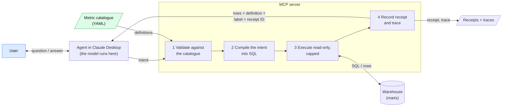
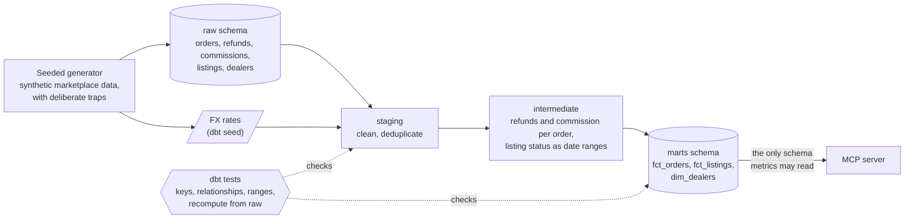
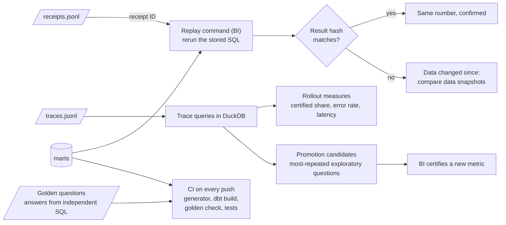

# Architecture: governed analytics MCP server

How a question becomes a number, and what is recorded on the way. Design choices and their reasons are in [DESIGN.md](DESIGN.md); the formats on each arrow are in [docs/contracts](../../docs/contracts/).

**The rule the whole design follows:** the model chooses *what* to ask for; code decides *how* it is computed. SQL on the governed path is never written by the model.

## Workflow: how a question becomes a number

| Step | What happens | Why |
|---|---|---|
| Validate | Metric, dimensions, grain and filter operators must be values the catalogue allows. Personal-data columns are in no list, so they cannot be named | Bad requests fail early, with the valid options in the error |
| Compile | Relative periods such as "last quarter" become absolute dates against a recorded as-of date. Dimensions and filters are sorted, values are escaped, and the output is byte-identical for the same intent | Two phrasings of one question give one query, and "last quarter" means the same thing on replay |
| Execute | A short read-only connection to the marts, with file and network access switched off, capped in rows and time | Least privilege |
| Record | The receipt is written before the result is returned; the trace covers failures too | Every number can be checked later |

## Where the data comes from

In production, this half belongs to BI: the marts come from their existing dbt project, and the server reads them through a read-only role from IT.

## Checking and learning from it afterwards

## Hard and soft controls

| Control | Kind | Where |
|---|---|---|
| Read-only connection with no file or network access, marts only, row cap, timeout | Hard | Server |
| Free-form SQL only through `explore_sql`: one SELECT over the marts, no personal-data columns, always labelled exploratory | Hard | Allow-list and server |
| Only catalogue metrics, dimensions and filters can be requested | Hard | Tool schema and compiler |
| Certified or exploratory label set from the catalogue | Hard | Server |
| A receipt for every answer | Hard | Server |
| Asking which "revenue" is meant, and quoting the label and receipt | Soft | Tool guidance and the `governed-analytics` skill, checked by golden questions |

## Status (17 Nov 2026)

All parts shown here are built and tested. The open items are listed in the README under "Deliberately not built" and "Who it hands off to".
