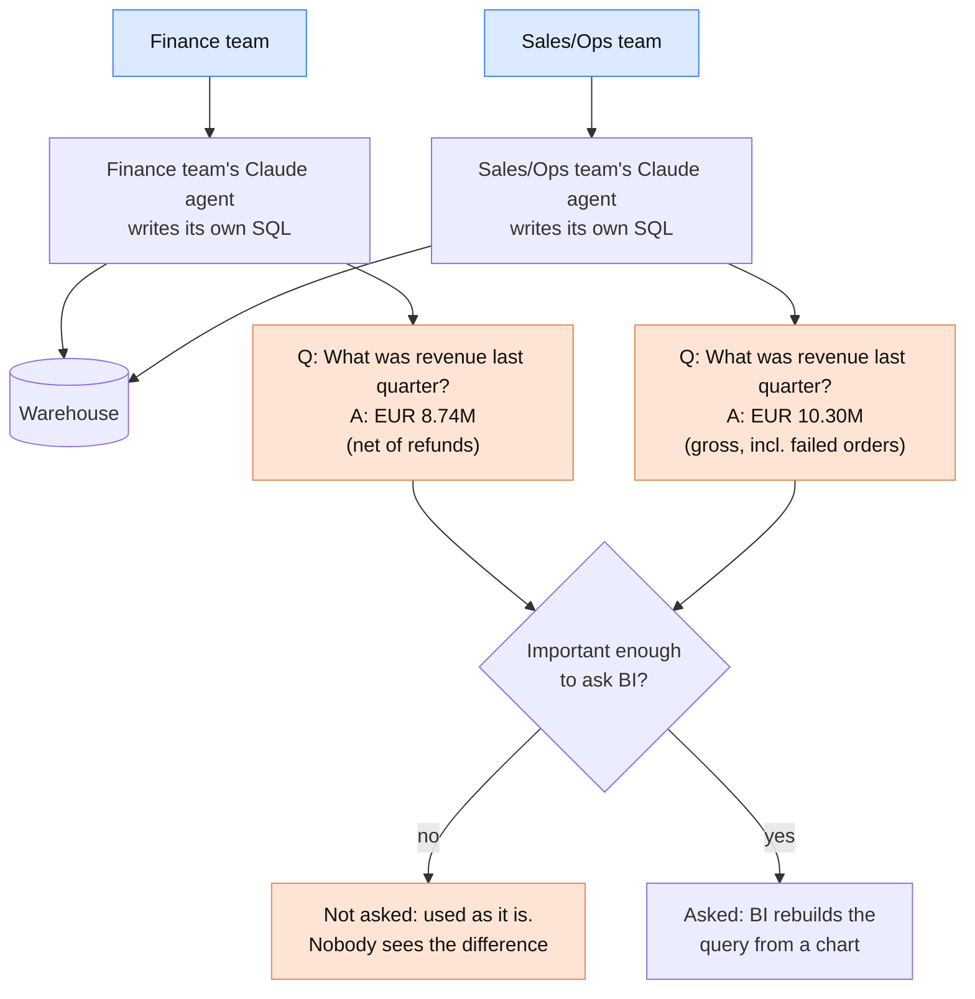
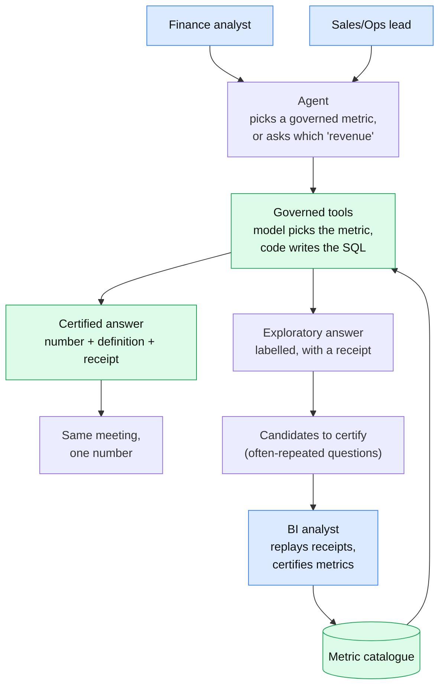

# Discovery brief: self-serve analytics drift

Produced with [`use-case-discovery`](../../skills/community/use-case-discovery/SKILL.md). The build it led to is described in [architecture.md](architecture.md) and [DESIGN.md](DESIGN.md).

## 1. Team and date

- **Date:** 14 Nov 2026
- **Teams:** Finance and Sales/Operations at a marketplace for watches, with BI as the data owner.
- **Status: assumed.** No real users were interviewed. The two personas and everything they "say" are assumptions, listed in section 5. The data is synthetic ([ADR-004](../../docs/adr/004-synthetic-data-and-traps.md)).

| Persona | Recurring questions | How they get numbers today |
|---|---|---|
| **Finance analyst** | Revenue, refunds and take rate for monthly and quarterly reviews | Their own assistant set-up, which queries the warehouse directly |
| **Sales/Ops lead** | Dealer performance and listings by region for the weekly sales meeting | A different assistant set-up, built separately, querying the same warehouse |
| **BI analyst** | Owns the marts and the metric definitions | Asked to review a figure only when someone thinks it is important enough |

### As-is process

Each team has built its own Claude agent against the warehouse. It is quick, and nothing ties the agents to one definition. A review by BI is optional, so whether a figure is checked depends on whether its author thinks it matters.

The two figures are real results from the example data: the same Q3 2026 orders give seven defensible readings of "revenue", from EUR 8.53M to EUR 10.30M on merchandise value alone ([ADR-004](../../docs/adr/004-synthetic-data-and-traps.md)).

### Should-be process

The speed stays. Both teams use the same governed tools, so there is one definition, and every figure can be checked without anyone having to ask. BI's job moves from reviewing charts on request to owning the definitions.

## 2. Opportunities

Scored 1 to 3 on each criterion with the skill's rubric.

| # | Task | Value | Data | Safety | Self-run | Total | Flags | Reason |
|---|---|---|---|---|---|---|---|---|
| A | Answer recurring revenue, refund and take-rate questions for monthly and quarterly reviews (Finance) | 3 | 3 | 2 | 3 | **11** | None | Holds up decisions; marts have an owner; a person reads the output before it is used |
| B | Dealer and listings performance by region for the weekly sales meeting (Sales/Ops) | 3 | 2 | 2 | 3 | 10 | None | Weekly; "active listings" has no agreed definition yet |
| C | Figures for the external investor pack | 2 | 3 | 1 | 3 | 9 | None | Reported externally, so it stays with BI and Finance sign-off |
| D | Correct a refund record or issue a dealer credit from the chat | 3 | 3 | 1 | 2 | 9 | Write access | Changes a system of record |
| E | Outreach lists of buyers or dealer contacts for a campaign | 2 | 2 | 1 | 3 | 8 | Personal data returned | Needs names and contact details in the output |
| F | A weekly KPI digest sent to every team automatically | 2 | 3 | 2 | 1 | 8 | Unattended for many teams | A platform job from day one |
| G | Forecast next quarter's refunds | 2 | 2 | 2 | 1 | 7 | Needs a trained model | Modelling and monitoring work |

## 3. Pick

**A: governed answers to recurring revenue questions**, with B carried on the same tools. B's listings metric stays labelled exploratory until BI settles its definition, which also exercises the path for questions the catalogue does not yet cover.

- **Access:** read-only, to the `marts` schema only, through three MCP tools (`list_metrics`, `describe_metric`, `query_metric`). No raw SQL on the governed path ([GR-01](../../requirements/GR-01-read-only-access.md)).
- **Personal data:** `fct_orders.buyer_id` is flagged as personal data in the dbt model. It is never a dimension or a filter, so it cannot be returned ([GR-04](../../requirements/GR-04-pii-protection.md)). The user's question is kept in the trace log only, with a retention period.
- **Success measure:** the share of figures in the monthly review that carry a certified label and a receipt, and so need no re-check by BI.
- **Owner in the team:** the Finance analyst runs it day to day. BI (`bi-finance`) owns the metric definitions.

## 4. Not now

| Row | Why | Talk to |
|---|---|---|
| D | Needs write access to a system of record | IT |
| E | Needs personal data to be returned, not just filtered out | IT (security) |
| F | Must run unattended for many teams from day one | Tool enablement |
| G | Needs a trained model, monitoring or an SLA | ML / data science |
| C | No stop flag, but the lowest safety score. Revisit once certified metrics have been in use for a quarter | BI and Finance |

## 5. Assumptions

Nothing here was heard from a real team. In particular:

- The personas, their questions and how often they ask them.
- That departments have built separate assistant set-ups against the same warehouse.
- That a BI review is optional and requested only for figures someone considers important.
- That figures reach BI as charts, without the query or definition behind them.
- That Finance can run the tool after a short handover.
- The warehouse layout, the metric definitions and every figure: all from the synthetic example data.

The first step with a real team is step 5 of the skill: play this back and correct it with them.
